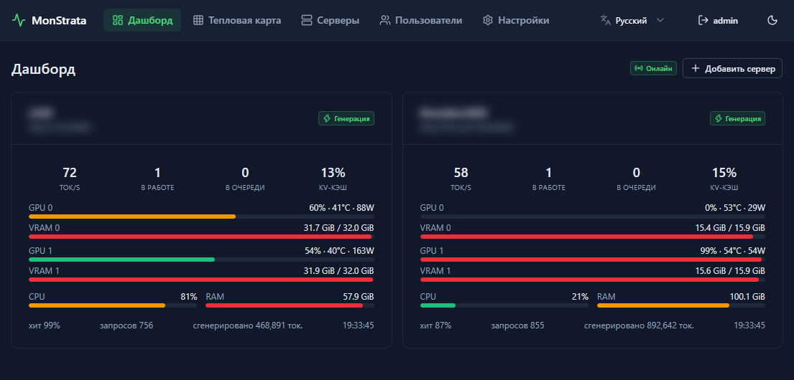
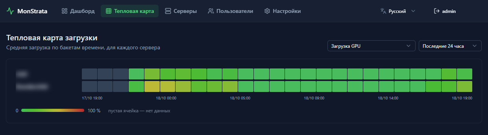

# MonStrata

[English](../README.md) · **Русский** · [中文](README.zh.md)

Web-мониторинг движков инференса **Strata**: несколько серверов, live-дашборд,
история метрик и тепловая карта загрузки с выбором периода.





## Возможности

- **Несколько серверов** — добавляете Strata-движок по базовому URL
  (например `http://192.168.10.76:8000`), метрики читаются с `/metrics`
  (Prometheus text format, заголовок `Accept: text/plain`).
- **Live-дашборд** — состояние движка (idle / reading / generating),
  tok/s, очереди, KV cache, по каждой GPU: util / VRAM / t° / мощность,
  CPU и RAM хоста. Обновление по WebSocket с fallback на polling.
- **История** — графики по каждому серверу за 1h / 6h / 24h / 7d / 30d.
- **Тепловая карта** — загрузка всех серверов по бакетам времени,
  периоды 1ч / 3ч / 12ч / 24ч / 7д / 30д / год, выбор метрики (GPU util, CPU, tok/s,
  очередь, VRAM %, мощность, hit rate и др.). Период и метрика запоминаются
  в браузере (cookie).
- **Настройки** — интервал поллера и интервал роллапа (по умолчанию 30 с),
  глубина хранения raw-данных и часовых агрегатов. Применяются на лету.
- **Тема** — светлая / тёмная / системная: быстрое переключение в шапке или
  выбор в Настройках; там же выбираются акцентный и нейтральный цвета
  палитры; хранится в браузере (localStorage).
- **i18n** — интерфейс на английском, русском, немецком, испанском, французском
  и китайском; язык определяется по браузеру и переключается в шапке
  (хранится в cookie `monstrata_locale`). Строки — в `i18n/locales/*.json`,
  новый язык = один JSON-файл + запись в `nuxt.config.ts`.
- **Опциональная авторизация** — включается `auth.enabled` в `config.json`;
  аккаунты хранятся в SQLite, пароли — хеш scrypt, вход держится 30 дней
  и продлевается при использовании, роли — `admin` и `user`. Если авторизация
  включена и пользователей
  ещё нет — приложение откроет экран создания первого аккаунта. Можно так же входить
  через GitLab-сервер в локальной сети (OAuth2, см. раздел «Авторизация»).

## Запуск

```sh
npm install
npm run dev        # http://localhost:3003
```

Продакшен:

```sh
npm run build
node .output/server/index.mjs
```

База — SQLite-файл `data/monstrata.db` (создаётся автоматически).
Путь меняется параметром `db.path` в `config.json` (применяется при старте).
Системные настройки — в `config.json` в корне проекта, см. раздел
«Авторизация» ниже.

## Авторизация

Системные настройки лежат в `config.json` в корне проекта — скопируйте
`config.json.example` в `config.json`:

```json
{
  "db": { "path": "data/monstrata.db" },
  "auth": { "enabled": true }
}
```

Файл опционален (нет файла — значения по умолчанию: `data/monstrata.db`,
авторизация выключена). `auth.enabled` применяется сразу при изменении файла,
`db.path` — при старте, после его изменения нужен перезапуск (относительные пути
отсчитываются от корня проекта). В отличие от страницы «Настройки» эти
переключатели намеренно требуют доступа к файлам — авторизацию нельзя
выключить из веб-интерфейса.

При включённой авторизации:

- пользователей ещё нет → приложение открывает экран создания первого аккаунта;
- каждый API-запрос и WebSocket требуют cookie `monstrata_session`
  (HttpOnly, пароли — хеш scrypt в SQLite, сессия живёт 30 дней и продлевается);
- две роли: `admin` и `user`; админы видят страницу «Пользователи», где можно
  менять роли, назначать любому новый пароль (без знания старого), замораживать
  аккаунты (замороженный не может входить, его активные сессии сразу сбрасываются)
  и удалять пользователей — последнего активного админа нельзя понизить,
  заморозить или удалить, а себя понижать и замораживать нельзя никому;
- серверы запоминают, кто их добавил: редактировать, удалять и переключать
  сервер может только его автор и админы (с выключенной авторизацией — все,
  как раньше);
- интервалы и хранение данных на странице «Настройки» правят только админы
  (карточки смены пароля и оформления остаются для всех);
- выход — кнопка в шапке; на странице «Настройки» можно сменить свой пароль
  (текущая сессия останется активна, остальные будут разлогинены).

### Вход через GitLab

Вместо локальных паролей (или рядом с ними) можно авторизоваться через
GitLab-сервер в локальной сети по OAuth2 (authorization code, область
`read_user`) — никакой отдельной IdP-службы не нужно:

1. В GitLab создайте OAuth-приложение (в профиле → «Приложения», или в
   Admin Area → «Приложения», чтобы предложить его всем) с redirect URI
   `http://<хост-monstrata>:3003/api/auth/gitlab/callback` и областью
   `read_user`;
2. внесите id/secret приложения в `config.json`:

```json
"auth": {
  "enabled": true,
  "gitlab": {
    "enabled": true,
    "baseUrl": "http://gitlab.lan",
    "clientId": "…",
    "clientSecret": "…",
    "allowedGroups": []
  }
}
```

- на странице входа появится кнопка «Войти через GitLab»;
- первый вход через GitLab создаёт локального пользователя с тем же логином
  и ролью админа (это возможно, только пока пользователей нет); последующие
  GitLab-входы создают обычных пользователей `user` — повышать их должен
  админ на странице «Пользователи»; новые GitLab-пользователи помечены
  значком «GitLab», пароля у них нет, и они могут задать локальный пароль
  в «Настройках» (форма попросит только новый пароль, без текущего), чтобы
  входить и при недоступном GitLab;
- `allowedGroups` (необязательно) пускает только участников указанных
  групп GitLab; участники подгрупп тоже подходят; пустой список — вход
  разрешён любому пользователю этого GitLab;
- `redirectUri` (необязательно) переопределяет выводимый из запроса callback
  — нужен только за reverse-прокси, меняющим хост.

Забыли пароль? На сервере, из корня проекта (никакой почты, сервер можно
не останавливать):

```sh
node scripts/reset-password.mjs --list
node scripts/reset-password.mjs <логин или id> [новый пароль]
```

Сброс разлогинивает все сессии пользователя.

## Хранение данных

| слой | разрешение | срок по умолчанию |
|---|---|---|
| `samples` | каждый поллерный цикл (~10 с) | 48 часов |
| `rollup_hourly` | часовые бакеты (avg/max/min) | 400 дней |
| `rollup_daily` | дневные бакеты | бессрочно |

Счётчики (`*_total`) при опросе превращаются в скорости (`derived:*`):
`gen_tok_s`, `prompt_tok_s`, `req_s`, средние по окну `_sum/_count` для
TTFT / ITL / E2E, проценты занятости движка и памяти.

## Структура

```
app/            Vue 3 + Nuxt UI фронтенд
  pages/        dashboard, сервер, heatmap, сервера, пользователи, настройки, login
  components/   ServerCard, MetricChart (uPlot), LoadHeatmap, ...
  plugins/live.ts  общий стейт + WebSocket-клиент
i18n/locales/   словари: en, ru, de, es, fr, zh
server/
  middleware/   auth.ts — гейта сессий для /api (включается config.json)
  utils/        парсер Prometheus, SQLite, каталог метрик, скрейпер,
                роллапы, примитивы авторизации, правила доступа, хелперы GitLab OAuth
  plugins/      фоновые циклы (scrape, rollups)
  api/          servers CRUD, live, range, heatmap, settings, auth, users
  routes/_ws.ts WebSocket-эндпоинт
scripts/        reset-password.mjs — восстановление пароля (без почты)
test/           тест парсера на реальных фикстурах (/metrics) + тесты авторизации
```

## API

- `GET|POST /api/servers`, `PATCH|DELETE /api/servers/:id`, `POST /api/servers/:id/ping` (PATCH/DELETE: с авторизацией — только автор сервера или админ)
- `GET /api/live` — текущие снапшоты всех серверов
- `GET /api/range?serverId&metric&from&to` — история метрики (raw/hourly/daily — источник выбирается сам)
- `GET /api/heatmap?metric&period=1h|3h|12h|24h|7d|30d|1y` — матрица серверы × бакеты
- `GET|PUT /api/settings` (`PUT`: с авторизацией — только админам)
- `/api/auth/status|setup|login|logout|password`, `/api/auth/gitlab/start|callback` — авторизация (публичные: status, setup, login, logout, gitlab/*)
- `GET /api/users`, `PATCH|DELETE /api/users/:id` — управление юзерами (только админы; PATCH принимает `role`, `disabled`, `password`)
- `WS /_ws` — push-снапшоты

## Тесты

```sh
node test/parse.test.mjs
node test/auth.test.mjs
node test/config.test.mjs
```

## Примечания

- Требуется Node ≥ 22.22 / 24.15 (на более старом Node 24 Nuxt 4.6 может
  ругаться EBADENGINE).
- В `nuxt.config.ts` два важных обхода окружения:
  - `nitro.externals.inline` — костыль под Windows до фикса
    [nuxt/nuxt#36467](https://github.com/nuxt/nuxt/issues/36467)
    (без него весь SSR отдаёт 500);
  - `nitro.experimental.websocket: true` — включает подключение WebSocket
    апгрейда в серверном пресете (иначе `/_ws` не работает ни в dev, ни в проде).
- `/metrics` Strata отдаёт JSON без заголовка `Accept: text/plain` —
  скрейпер всегда шлёт этот заголовок.
- Авторизация по умолчанию выключена (сервис для доверенной сети); когда
  включена — все `/api` кроме бутстрапа авторизации и `/_ws` требуют
  валидную cookie сессии.
